# agent-platform 设计文档

版本：v5.15.2（版本号唯一出处是 `src/agent_platform/__init__.py`，此处仅为导读快照）。读者：协作开发者。目标：看完本文即可定位任何功能的代码位置。

## 1. 定位与约束

内网 Agent 服务平台，为业务系统（Dagster、看板 board、配置中心）提供
报错分析、数据口径问答、定时巡检等能力。**单部署多目标环境**：一套服务
操作 prod/test/dev 多套业务环境，请求级 `env` 字段区分操作对象（见 §3.10）。

硬约束：

- 单部署：agent 服务只部署一份；业务环境差异是**请求维度**，不是部署维度
- 无用户体系：服务间调用只有一个固定 bearer token；/v1 与 webhook 统一校验（hmac.compare_digest），Viewer 页面走 cookie 登录（httponly，未登录 307 跳 /login），页面内 JS 调 /v1 由同源 cookie 兜底
- 单一内部模型 API（OpenAI 兼容），多 token 轮询
- 无容器：主机 + systemd 加固，沙箱用 bwrap（namespace 隔离）
- 角色/任务定义热生效：写 DB 即生效，不重启
- 钉钉单向中继：只发不收，交互闭环在 Run Viewer 页面上完成

## 2. 分层架构

依赖单向向下；跨层只走对方包的公开出口。新人读代码时，**每个文件不求助于
三个以上其他文件即可看懂**是本分包的硬标准。

```
api/        接入层：FastAPI app + /v1 路由 + 鉴权 + 请求模型
triggers/   触发层：dagster_sensor（规则先行）/ gitlab_webhook / chat（SSE）
orchestration/  编排层（Temporal）
  spec.py       RunSpec：一次 run 的完整规格（本层唯一数据结构）
  tasks.py      任务类型注册表（DB 声明 + 热生效；三种形态：artifacts/handler/单 agent）
  policies.py   提交闸门链：env_gate → DB 声明策略（deny/require_approval）
  artgraph.py   资产化任务图：纯逻辑解释器（topo 分层 + 层内并行 + map/route/gate）
  submitter.py  提交端：submit / run_sync / correct / resume_run / approve_start
                / cancel_run（terminate + cancelled 终态 + 挂起审批一并拒绝）
  workflows.py  AgentRun / ArtifactRun / BuiltinTask 三个 Workflow + Schedules 同步
  activities.py 执行步骤 + 结果投递（deliver_output：output_channel=http 回调 /
                dingtalk 中继，最终失败留 deliver_failed 事件不翻案 run 状态）+
                资产图 IO（art_materialize/art_gate/art_mark）+
                内建任务处理器（HANDLERS）+ 依赖注入（configure/Deps）
  worker.py     Temporal Worker 装配
agent/      agent 层
  roles.py      角色定义/继承解析（交集收敛防提权）/DeepAgents 装配
  engine.py     agent 生命周期：按需构建、TTL 惰性重建、热加载
  approvals.py  危险命令审批：DB 行是事实源，LISTEN/NOTIFY 毫秒唤醒；
                另有 list_pending/pending_count 供 Viewer 收件箱与角标
  tools/        工具层（见 §5）
memory/     记忆层：recall（运行前）/ distill（运行后）/ gardener（夜间维护口子）
store/      存储层：db（连接池+schema 唯一建表点）/ runs / definitions /
            knowledge（crud/retrieval/temporal/profiles）/ cases / feedback /
            artifacts（资产图产物：血缘 + 输入指纹复用）
model/      模型连接池：token 轮询 + 限并发 + 失败换 token
langfuse.py Langfuse 门面（官方 SDK 负责 prompt/score；平台保留 last-known
  + PG 写穿降级链）+ OTEL trace 管线（enabled=false 全空操作）
notify/     钉钉中继（四种消息形态）
viewer/     Run Viewer：overview/runs/approvals/chat/admin/memory 六页
            （审批页含收件箱列表与顶栏待办角标；总览页为 24h 聚合仪表盘；
            资产图 run 详情页内嵌 cytoscape 运行图）。服务端渲染：v5.1.0 起
            页面 = pages/*.py 组上下文 + Jinja2 模板（templates/，一页一模板，
            base.html 骨架 + _macros.html 共享宏，autoescape 默认开），
            模板不做查询、handler 不拼 HTML
main.py     装配入口：lifespan 内完成全部真实装配，无占位无延迟绑定
```

## 3. 关键设计决策

### 3.0 概念粒度总则：一个概念 = 一个独立生命周期

粒度判定尺子——一个概念值得成为独立粒度，当且仅当它同时具备
**独立的生命周期、独立的归属、独立的审计需求**；三缺一的维度做成
字段/过滤器（K8s labels 模式），不做成概念。

现有概念各回答一个问题：

| 概念 | 回答 | 归属与生命周期 |
|---|---|---|
| env | 平台部署在哪 | 配置级（conf/） |
| target_env | run 操作哪个业务环境 | run 字段；行为数据按它分区 |
| domain | 对哪个业务系统 | 域包在 git，行为数据在 PG |
| role | 谁来做（人设+工具集） | 定义表 (kind,env,name) 版本化 |
| task | 做什么（目标+形态+触发） | 定义表版本化 |
| session | 对话连续性边界 | run 的聚合键 |
| run | 一次执行的审计单元 | 事实表，钉死定义版本 |

定义自持 + run 钉死版本（task_version/role_version）是有意的：配置对象
托管给外部平台的迁移代价，OpenAI Assistants API 2026-08 退役已经演示过
一遍——prompt/工具声明必须在自家库里版本化。

**边界规则（写死）**：

1. **跨域不加「多域 run」**：run 永远只有一个 home domain（记忆分区、
   资产归属、权限边界都挂在它上面）。跨域诊断用会话组合（chat 追问串起
   两个域的 run）或任务图节点（每节点各自带域）表达。
2. **role 与 task 互不越界**：role 定义里不出现具体任务名，task 定义里
   不出现工具实现细节——role 是可复用的能力集，task 是目标。

**三个面的粒度**：管理面 = 定义版本（/admin 与 /v1/admin 只对版本操作：
新建版本/diff/回滚，不碰运行态）；对话面 = session；API 面 = run 为中心
的事实资源 + 平面过滤（`?env=&domain=&task=`），不做
`/domains/{d}/runs` 式嵌套路径——维度组合用过滤器表达，不用路径层级。

**env 一词两用（已知，有意为之）**：definitions.env 是**实例环境**
（定义按部署实例版本化），knowledge/cases/assets.env 是**目标业务环境**
（= run.target_env）。单实例管多业务环境时两者不冲突。
记账的未来项：当「角色版本按业务环境灰度」（先在 test 业务环境跑一周
再碰 prod）成为真需求，最小解是给 definitions 加可选 target_env 列
（NULL=全环境生效），不新造概念。现在不做。

**caller 约定**：caller 记身份、trigger_source 记来源通道，各管一件事；
`runs.create` 漏斗保证 caller 非空（缺省回退 trigger_source，见
store/runs.py）。审计按 trigger_source 聚合来源、按 caller 聚合身份。

**明确不要的粒度**：tenant/workspace/team（单内网）、角色子人格、
session 层级、多域 run——都不满足尺子的三个条件，出现真实需求前不加。

### 3.1 编排：Temporal durable execution

- workflow id = run_id；续跑 = 同 id 重新 start，
  `WorkflowIDReusePolicy.ALLOW_DUPLICATE_FAILED_ONLY` 只允许顶替终态执行
- 任务三种形态对应三个 workflow：单 agent（AgentRun）/ 资产图（ArtifactRun，
  run_graph 解释执行）/ 内建处理器（BuiltinTask，如 memory-gardener）
- Temporal Schedules 替代 pg_cron；任务定义的 schedule 字段启动时幂等同步
- run_agent 步骤不自动重试（模型/工具错误走人工或恢复路径）；
  prepare/finalize 轻量 DB 操作允许 3 次重试
- 审批等待在 activity 内 DB+NOTIFY 挂起 + heartbeat，Temporal 视为活跃

### 3.2 会话：概念唯一 session_id，episode 制

- 只有 session_id 一个概念；run 无会话归属时 session_id = run_id（自会话）
- session_id 即 LangGraph thread（checkpointer 持久化，崩溃断点续跑），
  但这是实现细节，不出 engine 层
- Dagster 报错场景：`dagster:{asset}:{error_class}:{date}`——
  episode 按天滚动，同类故障历史连续，跨类自动开新线
- 上下文不会长到爆：thread 只装本次故障周期，**连续性由记忆层承载**

### 3.3 记忆层：召回与沉淀

召回（recall，运行前拼 prompt）自上而下四层：

1. **资产档案**（`asset:{key}:profile`）：逐字保留、永不摘要，置顶
2. **前序交接摘要**（`session:{prefix}:{episode}:summary`）：四节模板——
   结论 / 被否方案 / 当前约束 / 未决问题（Compaction Cliff 的教训：
   散文摘要最先丢被否方案，而故障分析里"排除了哪些方向"最值钱）
3. **历史知识**：pg_trgm + pgvector 混合召回，RRF 融合（k=60，只认排名）；
   code_ref 带 commit，召回时校验新鲜度，漂移即标记 expired
4. **同类案例**：报错指纹归一化（抹掉数字/十六进制/引号/路径后 hash）

沉淀（distill，运行成功后）：一次轻量模型调用提炼知识/案例入库；
有 session 时另写交接摘要。沉淀失败不影响主流程。

### 3.4 纠正式反馈

`POST /v1/sessions/{sid}/feedback` → Submitter.correct：
从 session 最近 run **继承** task_type/role/domain（不调用方传、不写死），
新 run 在同一 session 带着纠正重判；finalize 时把**最近一次** run 沉淀的
知识/案例置 valid_to（不误伤更早的正确历史），再沉淀新结论。

同 session 被纠正 ≥3 次 → 管理页提示人工升舱为角色 prompt
（程序记忆升舱保持人工门）。

### 3.5 角色继承：收敛而非提权

- domains / tools 与父角色取**交集**——子角色只能收敛，不能扩张
- prompt = 父 prompt + prompt_append 拼接
- 加载时校验循环继承与父角色存在性

### 3.6 提交闸门链（policies.py）

所有"这个任务该不该发起"的判断收进唯一入口 `evaluate_submit`，按序短路：

1. **env_gate**（内置）：任务级环境门禁
2. **DB 声明策略**：definitions 表 kind="policy"，按 order 升序；
   正则作用于 任务名 + 输入 JSON + question，命中即按 action 处理：
   - `deny` → 直接拒绝（TaskRejected）
   - `require_approval` → 建行不启动（run 停 queued）+ 审批单 + 钉钉卡片；
     批准 → `approve_start` 首次启动 workflow（不是 resume——没有可续的
     thread），拒绝 → run 置 failed

不在链里的东西：dedup（是"合并到已有 run"，不是闸门决策，留在 Submitter）；
执行期危险命令审批（agent/approvals.py，管"这条命令该不该跑"）——
两层互补，一个管发起，一个管执行中。策略与角色/任务同机制：
DB 声明、版本化、写后即时生效，Admin API/管理页维护。

### 3.7 资产化任务图（artgraph.py）

静态 steps DAG 假设"工作的形状事先已知"，而 agent 任务的核心特征是未知。
所以任务图以**产物**为节点、**依赖**为边（数据流，不是控制流），
动态性只收进两个受控出口：

- 节点恰好声明一种物化方式：`code`（CODE_NODES 注册表里的内核函数，
  不过模型）/ `agent`（角色 + 产出契约，依赖产物以摘要注入，大产物用
  read_artifact 工具按需读）/ `route`（受限枚举选一——动态性出口①）
- 修饰：`map`（对上游 list 产物逐项扇出，运行时才知道几个——动态性出口②）
  / `gate`（`when` 条件命中 → 人工审批通过才物化，否则节点跳过、下游连带跳过）

执行语义：拓扑分层 + 层内并行（并行度是依赖关系的推论，不用声明）；
每个产物落 artifacts 表并带**输入指纹**（节点定义 + 实际输入的 sha256），
重跑时指纹未变的节点直接复用旧产物（本 run 优先，跨 run 取最新）——
这就是选择性再物化：只跑失败节点和下游脏节点。定义变更自动撑爆指纹
（定义在 hash 里），不需要手动失效。

解释器 `run_graph(spec, call)` 是纯逻辑：IO 全部经 `call(fn, *args)` 注入，
prod 里 `call = workflow.execute_activity`，测试里直接 await——
编排语义与 IO 解耦，单测不需要 Temporal。

### 3.8 域包（conf/domains/\<name\>/）

域知识从内核搬进域包，平台团队维护内核、业务团队 PR 自己的域包：

- `domain.yaml`：code_paths / readonly_dsn / hosts（该域服务实际部署的机器，
  host_metrics 查监控用）（与 common.yaml 内联声明深合并，内联优先）
- `rules.yaml`：规则分类器（dagster_sensor 的规则先行）
- `session.yaml`：episode 命名模板
- `tasks.yaml`：域自带种子任务（failure-analysis 住 dagster 包，frontend-smoke 住 board 包）

### 3.9 记忆园丁（gardener.py，#5 的口子）

记忆层的新陈代谢，定位为夜间低频维护作业（内建任务 memory-gardener，
种子默认不带 schedule；Admin 给任务定义加 cron 即启用，零新组件）。

- 已实现：**漂移巡检**——全库 code_ref 批量校验 commit 新鲜度，
  不一致标 expired（比召回时的惰性校验更主动：召回只管被命中的条目）
- 预留口子（接口就位，需求成熟时实现）：`decay()` 反馈分半衰期衰减、
  `find_conflicts()` 矛盾条目写"待仲裁"反馈（复用管理页升舱提示这条现成人门）

### 3.10 目标环境维度（单部署多环境）

`settings.env` 降级为**实例标签**：本套部署自己是谁，只用于定义/种子/策略的
存取命名空间（一套部署一套定义）。run 操作的**业务环境**是请求级维度
`target_env`，与实例标签正交：

- **入口**：`/v1/tasks`、`/v1/chat(.stream)` 的请求体 `env` 字段；
  dagster_sensor / gitlab_webhook 按来源环境上送；Viewer 对话页/列表页/
  记忆页带环境选择器；SDK/CLI 加 `--env`。缺省 = `default_target_env`
  （再缺省 = `target_envs[0]`，未配 `target_envs` 则退化为实例标签——
  单环境部署零感知）
- **贯穿**：`runs.target_env` 列落库；提交闸门链里 env_gate 与策略
  `PolicyDef.envs` 都按 target_env 判（"这个任务能不能打 prod"是目标环境
  问题，与部署在哪无关）；记忆层（knowledge/cases/反馈传播）按 target_env
  分区——prod 沉淀的口径不会污染 test 的召回；资产图产物同样按 target_env
  分区——跨 run 复用只在同环境内发生（test 物化的产物不能记到 prod 的账上）；
  域连接信息经
  `DomainConfig.for_env(target_env)` 取 `envs` 覆盖（深合并，一套定义连多套库）
- **校验**：配了 `target_envs` 后，请求带列表外的 env 直接拒绝
  （`resolve_target_env`，拼错环境名 = 打错环境，必须启动期/提交期暴露）
- 园丁逐环境巡检：内建 memory-gardener 对每个 target_env 跑一轮，
  输出按环境分组

### 3.11 任务资产（assets）：确定性靠收敛，不靠写死

记忆层的三类沉淀各管一件事：**知识记事实、案例记教训、资产记方法**。
任务资产是 run 产出的可复用产出，四类：`procedure`（方法/SOP，最有价值）/
`script`（脚本）/ `query`（查询）/ `baseline`（基线数据）。

两类载体（PG 是唯一元数据源：scope/复用数/反馈/生命周期；文件系统只是
内容载体，`path` 列非空 = 文件类资产）：

- **文本资产**：小文本直接存 `content` 列，召回时全文注入（它就是指令）
- **文件资产**：运行中写出的大产出（如自动化前端测试脚本）落
  `assets_dir/<env>/<域>/<任务|_shared>/<kind>__<name>/` 目录包，召回只注入
  **引用卡**（摘要 + 路径 + 使用说明 + 前 8 个文件名清单 + 「直接用不要
  重写」）——**代码不进上下文，只有执行输出进**（借鉴 Anthropic Agent
  Skills 的渐进式披露：目录卡常驻、正文按需、文件资源直接读）

- **写入**：`save_asset` 工具（有 asset_writer 才注册的条件工具）。
  两种收法：`content=` 直写小文本；`files=[scratch 相对路径]` 把已写好的
  文件/目录**收编**进资产库（整替换，staging + `os.replace` 原子换入；
  护栏：realpath 必须在 scratch 内、≤200 文件/≤50MB）——脚本等大产出走
  files 收编，拿稳定路径，后续 run 直接 `python3 <路径>/run.py`。
  域/任务/环境默认值由 prepare_run 注入的 ContextVar 补齐，来源 run
  自动留痕；upsert 幂等（同 域/任务/类型/名称 整替换），生命周期与
  知识库同款（软过期/恢复/反馈分）
- **召回**：prepare_run 按 `目标环境 + 域 + 任务` 取生效资产（任务级优先，
  同级内方法 > 基线 > 查询 > 脚本），拼成「任务资产」块注入 prompt
  （召回块之后、问题之前——最贴近执行的位置），注入即记 use_count；
  块内自带「发现已过时请用 save_asset 更新」的自我修正回路。
  沙箱内资产天然可读可执行（bwrap `--ro-bind / /` 全盘只读），写入口只有
  save_asset 工具（宿主侧可审计），安全模型零改动
- **首跑提示**：schedule 触发的任务若没有任何资产且角色带 save_asset，
  prompt 里加一句引导——首次运行探索并沉淀方法，后续调度自动召回遵循。
  确定性由此**收敛出来**（资产复用得越多，行为越稳定），而不是平台
  写死 DSL；扩展新任务仍然是零成本的自然语言
- **运营**：顶级「资产」页（与「记忆」平级）：侧栏域计数 + 类型统计条 +
  卡片（复用数/最近复用/生效状态/文件数）+ 抽屉（元数据、摘要/说明编辑、
  过期/恢复；文件类逐个在线查看内容，二进制给结构化回显）。手动登记只支持
  文本类——文件类由 run 里 files 收编产生。资产的「被用」就是注入那一刻，
  粒度足够，不另建埋点表

配套——**定时任务热生效**：`PUT /v1/admin/tasks` 保存定义后立即重同步
Temporal Schedules（失败只留痕，不阻断保存）；另有 300s 周期对账兜底
（外部改库/热同步失败时自愈到与任务定义一致）。

### 3.12 对外 API 契约（v5.12.0）

- **提交**：`POST /v1/tasks`（task_type/input/caller/role?/env?）；
  `Idempotency-Key` 头 = 调用方幂等键，24h 内同键重提返回首个 run
  （排队/运行中/成功均命中——任务级 dedup_key 只对成功 run 生效，拦不住
  "第一个还在跑"的重试；失败的 run 允许同键重提）。对话入口只有
  `/v1/chat(.stream)`（v5.11.x 起 /v1/ask 已删，二者重复且已漂移）
- **查询**：`GET /v1/tasks/{run_id}` 返回**字段白名单视图**（api.app
  `run_view`，DB 行结构是内部实现不进契约）；`GET /v1/runs` 透传
  status/task/source/domain/q/hours + keyset 游标（与 Viewer 同一
  list_filtered 实现，信封 {runs,total,next_cursor}）；
  `GET /v1/runs/{id}/events?after_seq=` 增量事件流（调用方观测进度）
- **控制**：`POST /v1/runs/{id}/cancel`（terminate + cancelled 终态；
  终态重复取消 409）；`POST /v1/runs/{id}/resume`；审批
  `GET /v1/approvals?status=pending|approved|rejected` +
  `POST /v1/approvals/{run_id}`
- **结果投递**：任务定义 `output_channel=caller|dingtalk|http` 由平台在
  workflow 终态后投递（deliver_output activity，Temporal 重试 3 次，
  最终失败留 deliver_failed 事件，**不翻案 run 状态**）；http 回调体
  `{run_id, task_type, status, output}`
- **错误模型**：`{"detail": 人类可读, "error_code": 机器可判}`；
  TaskRejected（未知任务/闸门拒绝/终态冲突）全局 400，超载 429——
  客户端错误永不冒泡成 500

### 3.13 运维操作面（v5.13.x）

Viewer 上的手工操作全部有 /v1 对应物——**Viewer 只是 API 的一个客户端**
（auth 同源 cookie 兜底，页内 JS 直接调 /v1），外部调用方（含 AI 运维）
与人走的是同一套能力。实现：api/ops.py（记忆/资产/统计）+ api/app.py
（run 控制/定义管理）。

- **记忆**：`GET /v1/knowledge`（清单，正文按需 `include_content`）、
  `GET /v1/knowledge/search`（检索试用 = 线上 recall 同款）、
  `GET /v1/knowledge/{id}`（明细 + 新鲜度 + 演化链 + 反馈 + 用量）、
  `POST /v1/knowledge`（upsert 幂等：同 env+domain+key 整替换）、
  `POST /v1/knowledge/{id}`（改内容）、`/expire`、`/restore`
- **资产**：`GET /v1/assets`（域/关键词/类型/状态过滤 + offset 分页）、
  `POST /v1/assets`（文本类登记，upsert 幂等）、`GET /v1/assets/{id}`、
  `GET /v1/assets/{id}/file?path=`（文件类在线读）、
  `POST /v1/assets/{id}/rollback/{ts}`（回滚到留档版本，当前版自动留档，
  v5.15.0）、`POST /v1/assets/{id}`、`/expire`、`/restore`
- **定义读取闭环**：三类定义单条 `GET /v1/admin/{roles|tasks|policies}/{name}`
  （活跃版本 + version 号）；任务/策略补齐 `history` 与
  `POST .../rollback/{version}`（角色早有；任务回滚后随即重同步 Schedule）。
  AI 的 read-modify-write 闭环靠这组接口
- **run 运维**：`POST /v1/runs/{id}/rerun`（失败续跑/成功新开）、
  `POST /v1/runs/{id}/steps/{seq}/feedback`（单步 👍👎，Langfuse 挂 span）
- **统计**：`GET /v1/stats?hours=24`（总览页同款聚合：状态计数 + 任务分布
  + 最近失败 + 待审批数）

### 3.14 编辑能力（v5.14.0）

写/改文件是一等能力，对齐主流 coding agent 的三件事：真实磁盘、写后验证、
改坏可回滚。

- **真实磁盘后端**：deepagents 默认 StateBackend 是虚拟 FS（文件存在 agent
  state 里）——edit_file 改完的文件 bash 看不见、save_asset 收不到。
  engine.py 装配时显式挂 `FilesystemBackend(root_dir=scratch,
  virtual_mode=True)`：文件工具与 bash/run_code 同一块地盘（write_file 写
  `/x.py`，bash 直接 `python3 x.py`），virtual_mode 把路径穿越（`..`、越界
  绝对路径）挡在后端层——文件工具不过 bwrap，写边界就靠这层。scratch 全
  run 共享（与 bash cwd 一致）：不做 per-run 隔离，否则文件工具与 bash
  看到的不是同一块地盘，编辑闭环反而断裂；撞名风险与 bash 现状相同
- **工具注入**：read_file/write_file/edit_file/ls/grep/glob 由
  FilesystemMiddleware 统一注入主控与全部子代理，不走角色白名单（种子角色
  tools 里声明 write_file/edit_file 只是意图文档，老库角色不声明也不影响
  注入）。语义同 Claude Code：write_file 不覆盖已存在文件，edit_file 精确
  字符串替换（先 read 再 edit）
- **写后验证**：种子角色 prompt 写明纪律——脚本写完必须 bash 跑通（.py 先
  `python3 -m py_compile`）再收编；save_asset 收编时 files 里的 .py（目录
  递归）强制 `compile()` 检查，不过则整体拒收
  （`assets_store.python_lint_errors`），prompt 纪律 + 工具硬卡口双保险
- **资产留档（后悔药）**：collect_files 整替换前把旧版目录整体改名进
  `<资产目录>.revs/<微秒时间戳>/`，保留最近 5 版（名即时间序，prune 按名
  排序）；`GET /v1/assets/{id}` 详情带 revisions 清单（时间戳/路径/文件数/
  字节），`POST /v1/assets/{id}/rollback/{ts}` 回滚到指定留档（当前版先
  自动留档，回滚可逆；v5.15.0 起资产页抽屉展示留档并可一键回滚）

## 4. 配置

`conf/base/common.yaml`（共享默认：模型/钉钉/temporal/审批模式/业务域静态拓扑）+ `conf/env/{env}.yaml`（只写差异，dict 深合并覆盖），
`${VAR}` 从环境变量插值，未设置启动即报错（配置问题暴露于启动期）。
`Settings` 扁平结构（config.py 一个文件看全）。

目标环境相关三个键（都不配 = 单环境部署）：

- `target_envs: [prod, test, dev]`：本实例可操作的业务环境白名单
- `default_target_env`：请求缺省 env 时的落点（建议指向 test——生产操作
  必须显式声明，是"默认安全"而非"默认方便"）
- `domains.<name>.envs.<env>`：域连接信息按环境覆盖（如 readonly_dsn、hosts），
  与基座深合并；`DomainConfig.for_env()` 在执行期解析

监控接入一个键（不配 = host_metrics 工具不注册）：

- `grafana: {url, datasource_uid, token}`：Grafana 地址 + Prometheus 类型
  数据源的 uid + 只读 service account token；查询走 datasource proxy
  （后端地址/认证收口在 Grafana，平台只见一个 token）

## 5. 工具层

分层：

| 层 | 工具 | 用途 |
|----|------|------|
| L0 | bash | 通用兜底（bwrap 沙箱：全盘只读/仅 scratch 可写/默认断网） |
| L2 | run_code | CodeAct：agent 写 Python 一次编排多工具，中间数据不进上下文 |
| 薄工具 | sql_query / host_metrics / dingtalk_send / update_asset_profile / save_asset | 带结构化校验的常用能力 |
| L1 | MCP 桥 | 内部服务的类型化接口：browser / datahub 直接接官方实现（微软 `@playwright/mcp`、DataHub 官方 `mcp-server-datahub`，配置见 conf/env/prod.yaml），仓库只自带 `mcp_servers/dagster_mcp.py`（内部 GraphQL 报错分析，无现成实现） |

- 每个工具在 `tools/registry.py` 只定义一次；`resolve()` 给 LLM（LangChain 壳），
  `host_tools()` 给 run_code 桩函数（无壳），同一实现
- 文件工具（read_file/write_file/edit_file/ls/grep/glob）不在 registry：
  由 deepagents 文件系统中间件统一注入，真实磁盘后端 root=scratch（§3.14）
- run_code 协议：沙箱子进程执行 agent 代码，桩函数经 stdio JSON 行
  （`\x00RPC ` 前缀）RPC 回 host 执行真实工具——host 是策略锚点（审查/鉴权/审计）
- 审查层与工具解耦：bash 命令与 run_code 代码走同一组危险模式审批
- sql_query 防线：单语句 + 只读事务 + statement_timeout=15s + 200 行上限
- host_metrics 防线：指标集固定（node_memory/node_load1/node_cpu/node_filesystem），
  PromQL 全由代码拼（instance 正则转义主机名，LLM 只选 domain/env）；
  经 Grafana proxy 查询不直连 Prometheus；采不到的主机显式列「无数据」；
  监控故障返回结构化错误不炸 run
- **为什么 bash 断网**：命令是 LLM 现场拼的，正则审批只拦得住 `rm -rf`，
  拦不住"GET 无害、POST 危险、这台机器不该碰"的 API 语义；要出网的能力
  全部收口成薄工具/MCP，把数据源与调用方式固化在代码里

## 6. 安全模型（由内到外）

1. systemd：低权限用户 + ProtectSystem=strict + 仅 scratch 可写 + NoNewPrivileges
2. bwrap：子进程 namespace 隔离；不可用时退化直接跑并记警告。
   **进程生命期**：`--unshare-pid --as-pid-1` 让命令做 pid ns 的 init——
   单次调用结束（正常/超时强杀/worker 崩溃经 --die-with-parent）内核
   SIGKILL 整个命名空间，`&`/nohup/setsid 起的后台进程必死，不可能泄漏
   （少这两个 flag 时 pdeathsig 只到直接子进程，孙进程会变僵尸，
   bubblewrap#529）。副作用：沙箱内 ps 只见本调用进程；跨调用起服务
   本就连不上（net ns 每次调用独立），合法模式只有"单次调用内起服务
   +验证"。bwrap 缺失时这一切消失——install.sh 会检查告警
3. 审批：危险模式（rm -rf/drop/truncate/kill/systemctl 等）挂起等人工放行，
   超时视同拒绝（安全侧默认）
4. 环境变量白名单：密钥不进模型上下文

威胁模型：内网可信用户 + 防误操作（不是对抗性代码）。

## 7. 存储 schema

`store/db.py` 是全库唯一建表点（启动幂等执行）。十张表：

- `runs` / `run_events`：执行台账与事件流（审计与排障的事实源）；
  `runs.target_env` 记录该 run 操作的业务环境（§3.10），knowledge/cases
  的 env 列同样填目标环境而非实例标签
- `definitions`：角色/任务/策略版本化定义（最新版本即生效，历史全留可回滚）；
  run 在 prepare 时固定所用版本（`runs.task_version`/`role_version`），
  排查可 diff 任意两版（管理页 `/admin/diff`），保存新版本时提示近 24h 旧版影响面
- `artifacts`：资产图产物（PRIMARY KEY(run_id, name) + target_env + input_hash +
  status：materialized/reused/skipped/rejected）——血缘与重跑复用的事实源，
  复用查询限定同一目标环境
- `knowledge`：知识库（时序化 valid_from/valid_to/superseded_by + expired +
  feedback_score + embedding）
- `cases`：案例库（报错指纹，UNIQUE(env, fingerprint)）
- `recall_hits`：召回埋点（每次真实召回按序记录命中 entry_id/run_id/rank；
  检索试用标记 source=playground 不计使用）——零召回/用量统计的数据源
- `assets`：任务资产（§3.11）：UNIQUE(env, domain, task, kind, name)，
  时序化生命周期与知识库同款；use_count/last_used_at 直接记行上；
  `path` 列非空 = 文件类资产（内容在 assets_dir 目录包，PG 只管元数据）
- `feedback`：反馈（rating=打分 / correction=纠正）
- `approvals`：审批单（执行期危险命令 + 提交闸门 + 产物闸门共用）

## 8. 观测

- Run Viewer（自托管）：总览页 `/`（近 24h 聚合仪表盘：状态计数/成功率/
  失败/运行中/待审批五张统计卡 + 最近 Runs + 待审批/最近失败 + 任务分布
  成功率条形图，SQL 聚合在 `store/runs.py: overview()`）/ runs 列表页
  （v5.11.0 重做：状态 chips + 时间范围 chips（24h/7 天/30 天）+
  环境/域/来源下拉 + 任务名与 run id·问题关键词搜索 + tokens/时长/时间
  可排序表头 + keyset 双向分页，`store/runs.py: list_filtered()`）/
  run 详情（**步骤时间线即唯一轨迹视图**：v5.5.0 起移除 v5.4.0 的自绘
  Trace 瀑布卡——线性 agent run 上瀑布内容被时间线完全覆盖，单独视图
  是重复；瀑布独有的增量信息（模型名/token/成本/真实耗时）并入时间线：
  state.json?trace=1 经 Langfuse observations API 取回 GENERATION span，
  与模型步骤按各自时序第 n 次对齐后行内联展示（`_span_meta`，展示用途，
  覆盖 thought 类步骤；反馈写回的精确映射仍走 match_observation 不含
  thought——思考行映射不上宁可降级 trace 级 score 也不瞎挂），运行中
  首拉一次、终态补拉一次覆盖入库延迟；「在 Langfuse 打开 ↗」缩为时间线
  标题行外链，Annotate/队列等深操作去官方 UI；有未决审批时页顶挂 ⏸
  待审批横幅）。
  **步骤时间线始终渲染**
  （节点级反馈的载体）：每步 👍👎（v4.11.0 起，
  kind=step + step_seq 留痕 feedback 表；Langfuse 回写经 match_observation
  把步骤 seq 映射到 observation id，score 直接挂对应 span——等价 UI 的
  Annotate 但走 public API，不需要登录态；映射不上降级 trace 级 score
  `step#seq`；单步评分不传播记忆）。**终态 run 头部带重跑按钮**（v4.11.0
  起，POST /runs/{id}/rerun → Submitter.rerun：失败/终止 → 同 id 断点续跑
  （ALLOW_DUPLICATE_FAILED_ONLY），成功 → 同输入新开 run 且跳过去重，
  trigger_source=rerun 留痕）。时间线每步带距上一步耗时（+N.Ns），
  长输出默认折叠（Claude Code 式，点击展开）；失败 run 的末事件报错
  提到顶部红色横幅；最终输出按 Markdown 渲染（与对话页一致），输入的
  question 以正文呈现、完整 JSON 折叠；输入/输出卡带复制按钮；头部
  「在对话中继续 →」带 session 跳对话页续聊（v5.3.0 起）。运行中详情页 2s
  增量轮询（`state.json?since=<seq>` 只回新事件，v5.3.3 起；v5.11.1 起
  seq 过滤推进 SQL 的 `get_events(after_seq)`，图事件走独立一行查询——
  长 run 的 DB→应用传输也降到 O(1) 每轮；对话页流式步骤同样增量追加
  DOM 不重绘）。
  资产图任务渲染产物血缘
  图，按 materialized/reused/skipped/rejected 染色；详情头带目标环境徽章）/
  审批页（`/approvals` 收件箱列表是钉钉 deep-link 之外的兜底入口，
  顶栏「审批」挂待办数角标，on-load 拉一次不轮询；v5.11.0 起分
  待办/已处理两个 tab——待办按发起时间升序（SLA：最久等待优先，
  列表直接显示等待时长），已处理按决定时间倒序带结果/操作人留痕，
  补上了此前「处理完即消失」的审计缺口；`/approvals/{run_id}`
  处理页）/ 对话页（v5.3.0 重做：会话侧栏（web_chat 台账聚合，最后活动
  倒序）+ 历史回放 + Markdown 结论（vendor marked + DOMPurify，无构建）+
  过程步骤折叠 + 结论 👍👎 直接反馈（同源表单端点）+ 停止/重试/错误气泡；
  run 详情头「在对话中继续 →」带 `?session=` 跳回——同 session 续聊自动
  继承该 run 的上下文/记忆，配置从会话最新 run 回填；环境选择器）/
  管理页（v5.6.0 重做：角色/任务/策略的列表 + 编辑器双栏——左栏带版本
  号与近 24h 用量角标，右栏结构化表单（已知字段专用控件：工具/域/环境
  复选框、prompt 大文本、输出渠道下拉），未知字段收进「高级 JSON」保存
  时合并、不静默丢字段；版本时间线点击两条出内联 diff，角色可一键回滚
  到历史版本；保存走 `/v1/admin/*` 既有 API）/
  记忆管理页（v5.8.0 运营闭环：域侧栏 + 页头健康度条（生效/零召回/
  负反馈/漂移/待仲裁）+ 召回埋点 recall_hits（真实召回按序记录，试用
  标 playground 不计使用；条目卡带近 30 天命中数，抽屉列命中明细）
  + 检索试用（recall_block 本身，返回注入 prompt 全文块）+ 手动新增
  + 反馈统一加权召回终排与负反馈处置提示；编辑重算向量、演化链、
  案例库、向量相似矛盾仲裁为既有能力；v5.11.0 起页头显示「本域 N 条」
  与 500 上限提示——记忆页是列表套件有意的例外：健康度条与逐条
  新鲜度需要域内全量集合，不做分页）/
  资产库页（v5.10.0 起，见 §3.11；v5.11.0 补齐过滤与分页：域侧栏
  计数 + 类型/状态 chips + 名称/摘要搜索 + offset 页码）

  **列表页统一套件**（v5.11.0）：六个列表页（Runs/审批/资产/记忆/管理/
  总览 mini 列表）共用一套做法。**URL 即状态**：过滤/排序/翻页全部落在
  query string（`page_url()` 助手做参数合并与空值删除），可分享、刷新
  不丢；交互用普通 GET 表单 + 链接，无 JS 也能用（管理页的名称过滤框
  是唯一例外——本地定位器不进 URL）。**时间全站归一**：服务端
  reltime/abstime/dur 三个 Jinja 过滤器 + `ts` 宏（相对时间正文 +
  绝对时间悬停），消灭各页自造的时间格式。**分页按表的气质选型**：
  runs 是追加型高 churn 表，用 keyset 光标分页（游标 =
  `排序值|created_at|run_id` 三元组，`after`/`before` 双向，翻页
  不随新数据漂移）；审批/资产低 churn 用 offset 页码。`chips` /
  `sort_th` / `pager` / `ts` 四个 Jinja 宏加一组 CSS 类即套件全部，
  新列表页直接组合，不引前端框架。

  页面实景（全栈截图，见 `docs/screenshots/`）：

  | 总览 | Runs 列表 | Run 详情 |
  |---|---|---|
  | 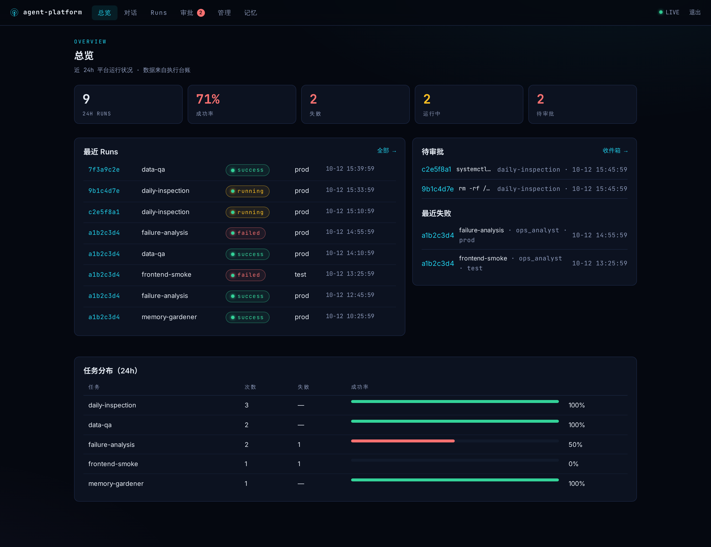 | 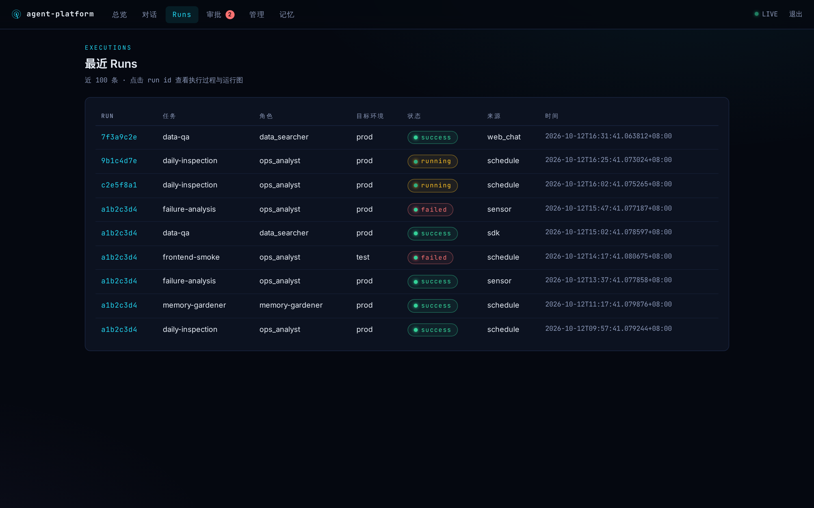 | 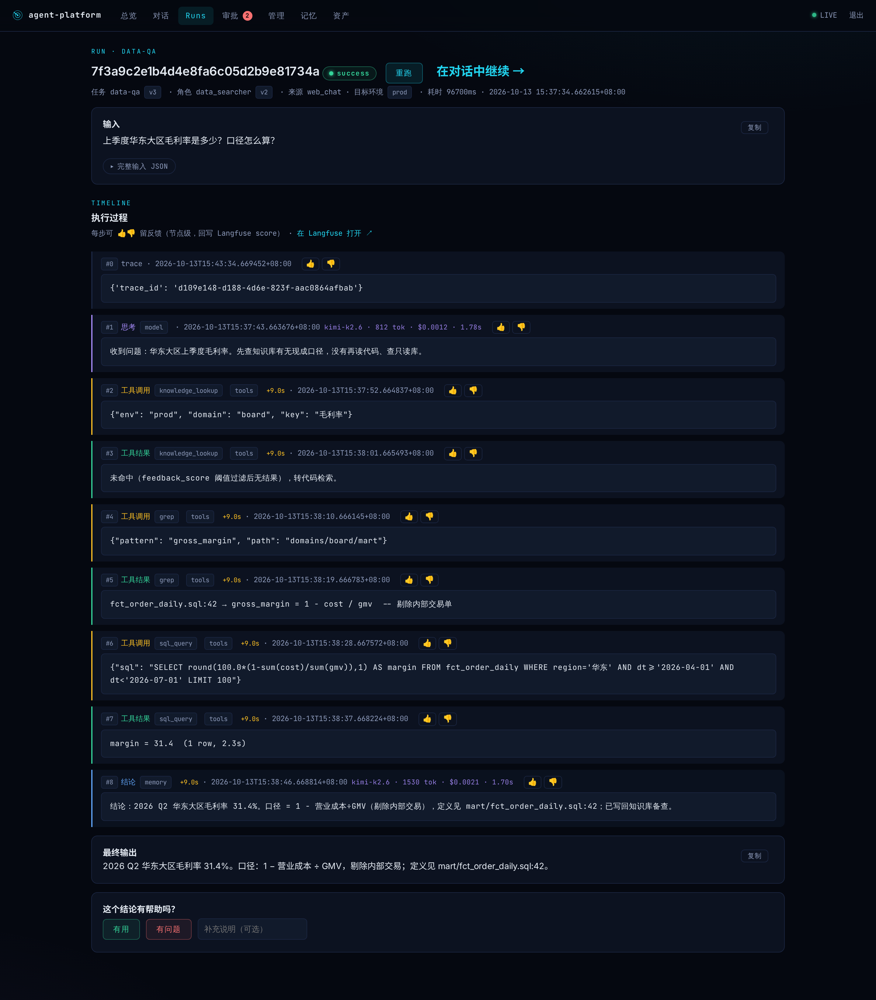 |

  | 审批待办 | 审批详情 | 对话 |
  |---|---|---|
  | 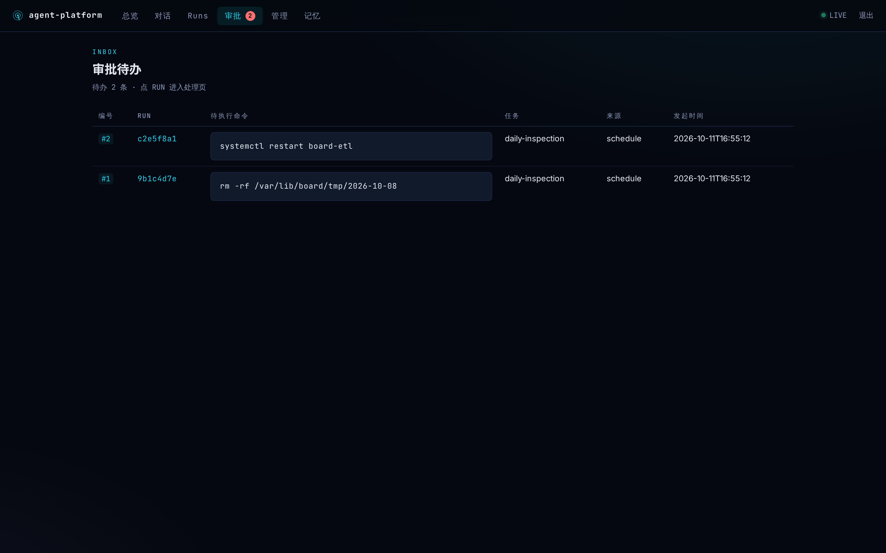 | 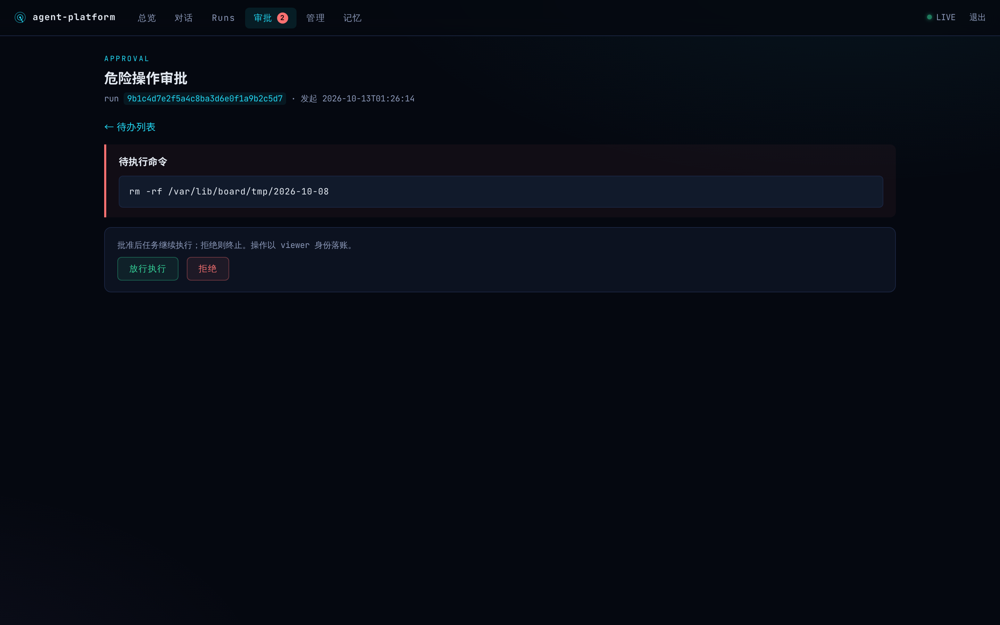 | 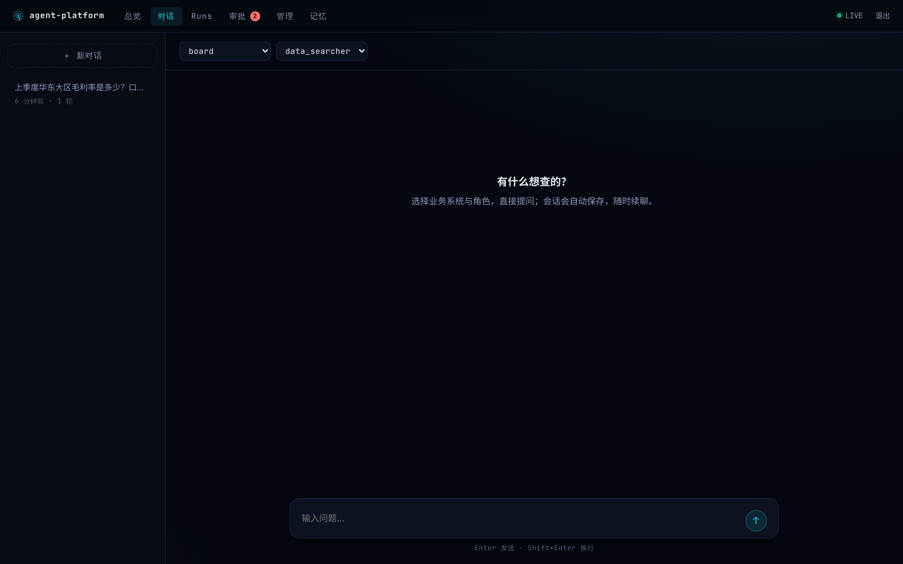 |

  | 管理 | 记忆 | 资产库 |
  |---|---|---|
  | 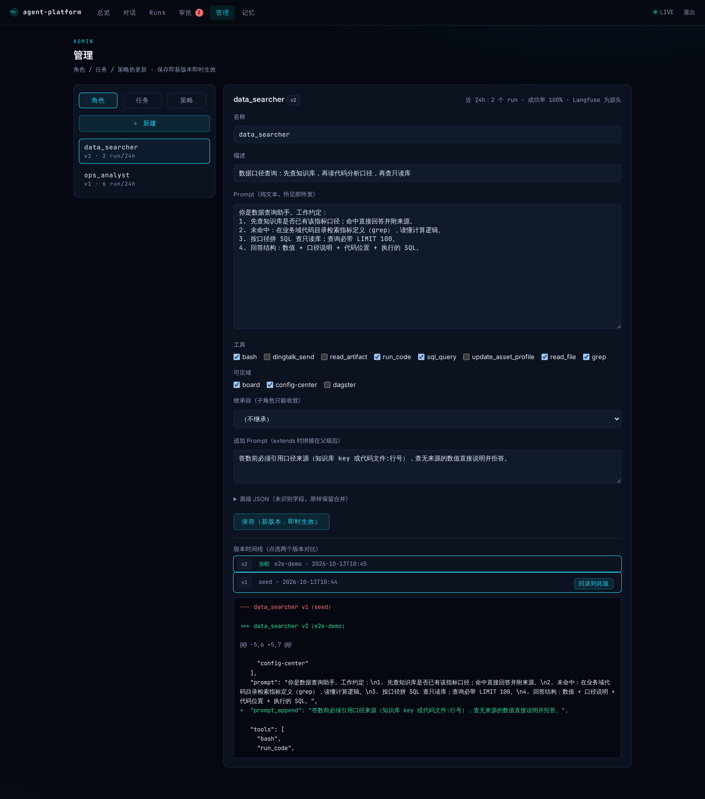 | 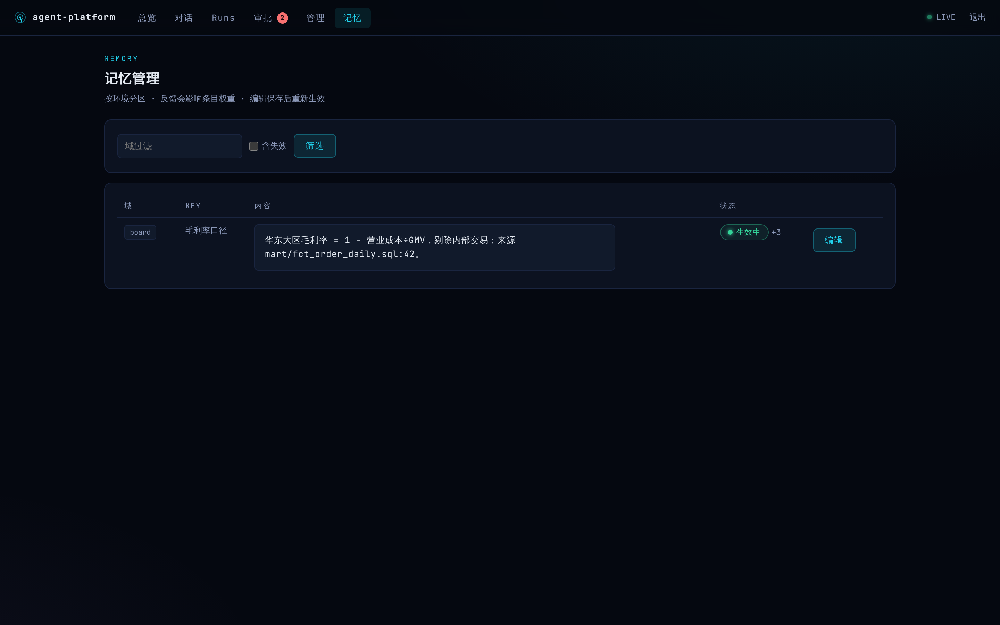 | 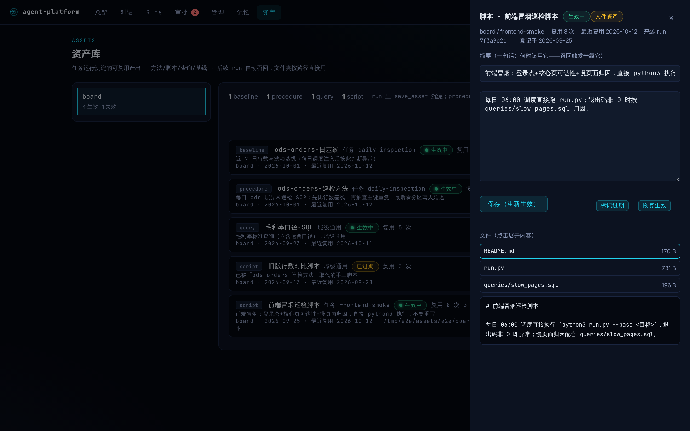 |

  | 对话（历史回放） | 审批已处理 | 登录 |
  |---|---|---|
  | 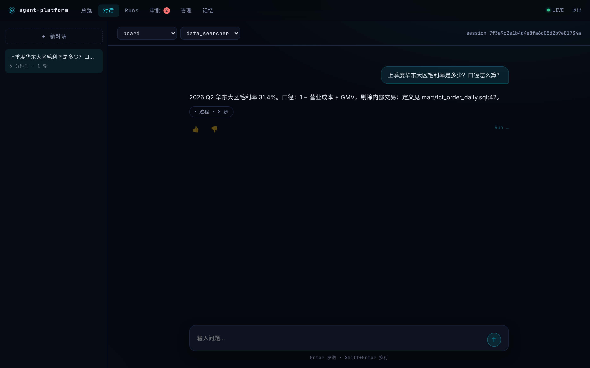 | 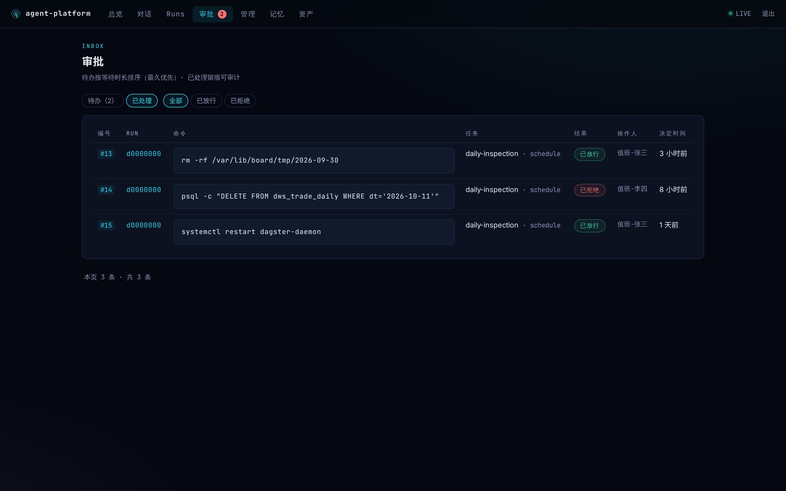 | 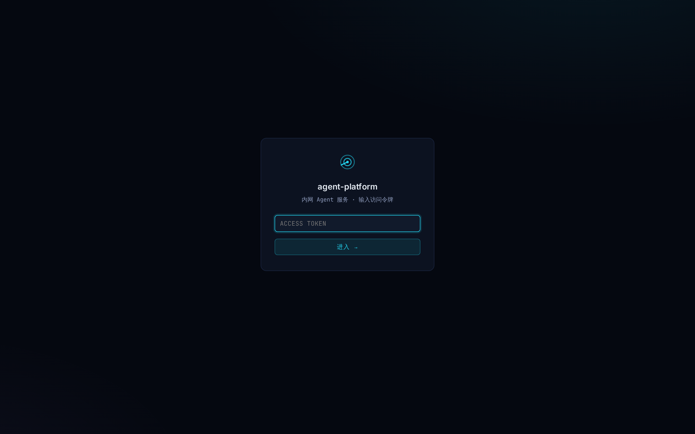 |
- Langfuse：官方 SDK（prompt 源头：name=`role:<name>`，label 灰度，SDK 自带
  TTL 缓存与写入失效；反馈 score 批量回写，关停前 flush）+ OTEL trace
  （`/api/public/otel/v1/traces`，官方摄入路径）；观测数据消费走 public
  API：`/api/public/observations?traceId=` 取 GENERATION span 的
  模型/token/成本回填 run 详情页步骤行（v5.5.0 起；节点级反馈的
  seq→observation 映射同用此接口），`/project/{pid}/traces/{tid}`
  （project id 经 public API 解析一次并缓存）只作「在 Langfuse 打开」
  外链——v5.4.0 起移除 iframe 内嵌及其公开链接发布/剥头探测整套
  机制（`embed`/`publish` 配置项一并删除）
- 降级：SDK 失败走进程内 last-known-good → PG 写穿缓存；Langfuse 未启用时
  角色直读 PG definitions 表，trace 不发送，链路不断

## 9. 部署

主机 + systemd（无容器）。**agent 服务只部署一份**（多目标环境是请求维度，
§3.10）；同机业务服务由 svcrun 按需纳管（§9.1）：

```bash
deploy/install.sh prod   # 低权限用户 + 代码包 root 只读 + systemd 加固
```

- `deploy/agent-platform.service`：主服务
- `deploy/temporal-server.service`：Temporal（持久层可复用现有 Postgres）
- `mcp_servers/`：仓库自带的内部 MCP server（FastMCP stdio 独立进程，server 端
  依赖走 pyproject 的 dagster-mcp extra）；browser / datahub 用官方实现——
  `@playwright/mcp`（npx，需 Node.js）和 `mcp-server-datahub`（uvx，需 uv），
  是独立外部运行时，不入 Python 依赖
- secrets 走 `/etc/agent-platform/secrets.env`（640 root:agent-svc）

### 9.1 同机业务服务：svcrun 按需纳管

与 agent 同机的业务服务（dagster/board/config-center…）几乎只有配置文件
不同，不值得按环境各常驻一套。`svcrun.py` 把它们收进一张注册表
（`conf/services.yaml`），环境变成启动参数：

```bash
python3 -m agent_platform.svcrun dagster-webserver test
```

设计要点：

- **配置隔离用 bind 而不是命令传参**：选中环境的配置文件 bwrap bind 到
  服务本来就读的固定路径（`dagster.yaml ← dagster.test.yaml`），
  服务零改动且不可能拿错环境；其他环境的同名文件遮蔽为 `/dev/null`
  （不依赖服务支持配置参数，也没有"忘传参数读到默认配置"的坑）
- **生命周期随会话**：`--die-with-parent`，启动它的 shell/SSH/tmux 结束，
  服务自动结束；要多套同起，`ports` 给每环境配端口，cmd 里用 `{port}` 占位
- **纳管成本一行起**：新服务在 services.yaml 加一段（cmd + configs 映射）即可；
  声明期校验（缺 cmd/缺 envs/配置文件不存在）在启动前暴露
- bwrap 缺失直接报错——这里隔离是目的本身，与工具沙箱的"退化可用"相反

## 10. 测试策略

- `tests/test_units.py`：纯逻辑（配置/域包加载/角色继承/SQL 校验/hostinfo
  指标渲染/bash/run_code RPC/指纹/session_id/Spec/ModelPool/资产图拓扑与闸门），
  无外部依赖
- `tests/test_store.py`：PG 存储层（pgserver 内嵌 Postgres，无需 root）
- `tests/test_platform.py`：端到端（真实 PG + fake 模型/agent/Temporal client）：
  全链路/纠正/dedup/定义版本谱系/策略链（deny、require_approval 放行与拒绝）/
  目标环境（落库/env_gate/策略 envs/记忆分区//v1/runs 过滤）/
  资产图（端到端、跨 run 复用、gate 审批两路）/ 园丁巡检 / API 与 Viewer
- `tests/test_mcp_servers.py`：官方 MCP server 工具清单冒烟（验证 prod.yaml 示例
  命令在本机可启动可列工具，防配置漂移；npx/uvx/fastmcp 缺失自动跳过）
- Temporal 的编排语义（重试/恢复/调度）由集成环境验证，单测聚焦业务逻辑
- 资产图解释器靠注入 `call` 纯逻辑测试；`run_graph` 不碰 DB/Temporal
工具，防配置漂移；npx/uvx/fastmcp 缺失自动跳过）
- Temporal 的编排语义（重试/恢复/调度）由集成环境验证，单测聚焦业务逻辑
- 资产图解释器靠注入 `call` 纯逻辑测试；`run_graph` 不碰 DB/Temporal
